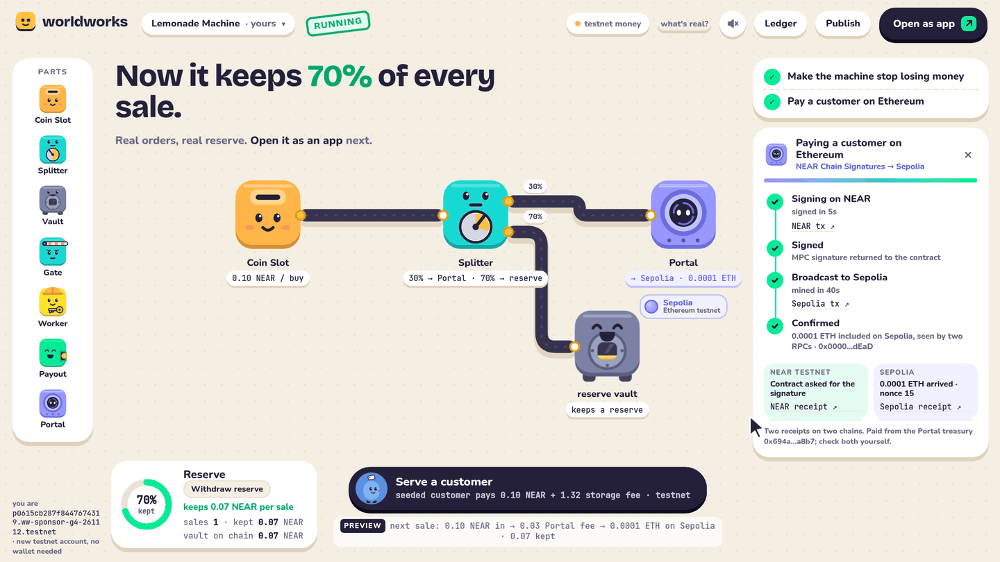

# WORLDWORKS

Wire money machines from parts in a browser game; each machine runs on a NEAR testnet contract, can pay out Sepolia ETH through NEAR Chain Signatures, and opens as its own app at `/m/<id>`.



*Live NEAR testnet + Sepolia run, 2026-11-13, recorded with the current configuration: 1.32 NEAR order storage fee, 0.0001 ETH payout, "included on Sepolia, seen by two RPCs" ([recording log](docs/demo/RECORDING-LOG.md), [earlier evidence](docs/EVIDENCE-ui-live.md)).*

**What and why.** Most payment rules live in application code that the payer cannot read. In WORLDWORKS a payment rule is a machine built from seven parts (Coin Slot, Splitter, Vault, Gate, Worker, Payout, Portal), and the machine you publish is the graph that one shared NEAR contract executes for every order. A Portal part pays Sepolia ETH from a treasury address controlled by that contract through Chain Signatures, and the relayer that broadcasts the signed transaction holds no EVM key.

## Try it

App: **{{HOSTED_URL}}** · Demo video and post: **{{DEMO_POST_URL}}**

The hosted app runs in live mode: your browser gets a new sponsored NEAR testnet account and the steps below send testnet transactions. If a **MOCK DATA** badge is visible, nothing is on chain.

1. **Open the app** → the *Lemonade Machine* loads with a **BROKE** stamp: every sale goes to the Portal and the machine keeps nothing. A testnet account is created for you (funded with 3 test NEAR); no wallet is needed.
2. **Drag *Splitter* from the Parts column onto the pipe between Coin Slot and Portal** → a reserve Vault appears, the split reads `30% → Portal · 70% → reserve`, and the stamp changes to **RUNNING**.
3. **Click *Serve a customer*** → the machine is published from your account (0.40 NEAR refundable deposit), a seeded customer pays 0.10 NEAR + 1.32 NEAR order storage fee, and the Reserve card shows 0.07 NEAR kept on chain.
4. **Watch the Portal panel** → *Signing on NEAR* → *Signed* → *Broadcast to Sepolia* → *Confirmed: 0.0001 ETH included on Sepolia, seen by two RPCs*, with a NEAR receipt link and a Sepolia tx link. The recorded live runs took 57.7 s and 87.6 s for the whole workshop flow ([INT-1](docs/EVIDENCE-ui-live.md), [G6](docs/EVIDENCE-g6.md#ui-flows)).
5. **Click *Ledger*** → each order row with its NEAR and Sepolia links. **Click *Open as app*** → the same machine opens at `/m/<id>` with its own checkout; paying there creates a new order and a new Portal payout ([screenshot](docs/design/screens/live-07-app-paid.png)).

## Verify it yourself

| | |
|---|---|
| NEAR contract | [`ww-portal-261112.testnet`](https://testnet.nearblocks.io/address/ww-portal-261112.testnet), code hash `2asqVNPwvj4YvJb9kztRvWDJvzSbwpmjntDsMgrGVYwv` (equals a local build of `contract/` at this commit) |
| Portal treasury (Sepolia) | [`0x694Ad57416073B1E1f3BC6E13B26BDE28015A8b7`](https://sepolia.etherscan.io/address/0x694Ad57416073B1E1f3BC6E13B26BDE28015A8b7), derived from the contract for path `worldworks/portal/sepolia/v1` on signer `v1.signer-prod.testnet` |
| Key status | **Not yet key-locked:** the contract account still has one FullAccess key. It will be removed with [`scripts/lock-contract.sh`](scripts/lock-contract.sh) before submission. <!-- LOCK-STATUS --> |

| Event | NEAR testnet | Sepolia |
|---|---|---|
| Workshop order → payout 13 (G6 live UI run) | [8fenUDQh…](https://testnet.near.rocks/tx/8fenUDQhqDSP3nj5tm1QMP1o2zQE4L4jpWecrrDNMmfv) | [0x0774069a…](https://sepolia.etherscan.io/tx/0x0774069a6dc5de2e07954679d84b661f1b2903b73022827a3228f52e9cf6f69a) |
| Standalone app order → payout 14 | [EPRjxQrk…](https://testnet.near.rocks/tx/EPRjxQrkWcFVPvkTkMgwHhvdppRDSUr6spNCxr2wvuoe) | [0x1939226a…](https://sepolia.etherscan.io/tx/0x1939226aaa336cd2eec0963f92b6e521ebd71e038240be9666f67c2f3d67358a) |
| First contract-built payout (payout 0) | [5gVpK4eF…](https://testnet.near.rocks/tx/5gVpK4eFaaFFfmEJsj1UWb3oEWmGVjLmXBqzysiPkQJN) | [0xbf2a7ae1…](https://sepolia.etherscan.io/tx/0xbf2a7ae14ef28044ce775f9c18ed0c6294ffe916aac1f84653253b51f9d0a3e6) |
| G6 deploy + migration (same transaction) | [8oq6PwTe…](https://testnet.near.rocks/tx/8oq6PwTecJNV8NzEMH4nEWjsiARzhUQzejH3BGj1w9GN) | — |
| Owner sets Portal fee cap to 3 gwei | [HCVpGfes…](https://testnet.near.rocks/tx/HCVpGfesqzDKvpFn5aAoc74RZGYR7ck3sin5fpBT5pa7) | — |

Every command below only reads state; none sends a transaction. Needs Node 22, npm and `jq`.

```sh
git clone https://github.com/emmaGH1/worldworks.git && cd worldworks/app && npm ci
# Payout 13: rebuild the signed bytes from contract state, recover the sender, check both Sepolia RPCs
npm run --silent confirm -- 13 | jq -c '{status, rpcs: [.confirmations[].rpc], blockHash: [.confirmations[].blockHash] | unique}'
RPC=https://rpc.testnet.fastnear.com; H='Content-Type: application/json'
curl -s $RPC -H "$H" -d '{"jsonrpc":"2.0","id":1,"method":"query","params":{"request_type":"call_function","finality":"final","account_id":"ww-portal-261112.testnet","method_name":"get_limits","args_base64":"e30="}}' | jq -r '.result.result | implode'
curl -s $RPC -H "$H" -d '{"jsonrpc":"2.0","id":1,"method":"query","params":{"request_type":"view_access_key_list","finality":"final","account_id":"ww-portal-261112.testnet"}}' | jq -c '[.result.keys[].access_key.permission]'
```

Expected (run 2026-11-13): `{"status":"confirmed","rpcs":["https://rpc.sepolia.ethpandaops.io","https://sepolia.gateway.tenderly.co"],"blockHash":["0xc85a79c6…bf75"]}`; `get_limits` returns `"order_storage_fee":"1320000000000000000000000"`, `"publish_storage_deposit":"400000000000000000000000"`, `"epoch_payout_count_cap":20`, `"epoch_budget_wei":"10000000000000000"`; the key list is `["FullAccess"]` until the lock script runs, then `[]`. `npm run confirm -- 0` checks the first payout the same way.

## Current configuration

Source: [G6 evidence](docs/EVIDENCE-g6.md) and [contract usage](contract/USAGE.md); NEAR values are read back by `get_limits` above.

| Setting | Value |
|---|---|
| Order storage fee (retained) | 1.32 test NEAR per order: twice a 65,536-byte lifecycle bound × 10^19 yoctoNEAR/byte ([derivation](docs/STORAGE-g6.md)) |
| Publish deposit | 0.40 test NEAR; unused storage deposit is refunded |
| Sponsored session | 3 test NEAR per new browser account |
| Portal epoch | 0.01 Sepolia ETH budget per 1,000 NEAR blocks; each payout reserves value + 21,000 × snapshot max fee per gas; at most 20 payouts per epoch |
| Per payout | at most 0.002 ETH; NEAR sent to the Portal must be ≥ wei × 10^6 yoctoNEAR |
| Fee snapshot | max fee 3 gwei, priority 1 gwei (owner call above; applies to payouts created after it) |
| Template payout | 0.0001 Sepolia ETH ([`DEMO_WEI`](app/src/lib/machine.ts)) → reserves 0.000163 ETH, so the 20-payout cap binds before the budget |
| "Confirmed" in the UI | matching successful transaction and receipt on two independent Sepolia RPC hosts, plus at least 3 blocks on top on both |
| Server funding caps | 35 test NEAR/h sponsor, 20 test NEAR/h customer, per server process |

Payouts 0–14 above were 0.001 ETH under the earlier 100 gwei fee snapshot. Payouts 15 and 16 were made at the 3 gwei / 0.0001 ETH settings during the demo recording, e.g. payout 15: [NEAR order](https://testnet.near.rocks/tx/Gah48XxvFzjks1uDVrN5Poi3DYMc8XPp7KzRyL4csGBe), [Sepolia](https://eth-sepolia.blockscout.com/tx/0xe1037289c605bd67737874942182d66a755ea3b1c74aaa601e818f46614f5eb5) (see docs/demo/RECORDING-LOG.md). If the Sepolia base fee rises above 3 gwei, payouts already signed with this cap keep their signed fee and wait in the mempool until network fees fall back under it; because nonces are sequential, later payouts wait behind them. Raising the cap only affects payouts signed afterwards.

## How NEAR is used

| Behavior | Implementation | Evidence |
|---|---|---|
| The browser generates a key; the server creates and funds a sponsored testnet account for it (3 NEAR, idempotent per public key). Sponsor and customer keys stay server-side. | [`app/api/session.ts`](app/api/session.ts), [`app/src/api/live.ts`](app/src/api/live.ts) | [live UI](docs/EVIDENCE-ui-live.md), [G6](docs/EVIDENCE-g6.md) |
| A Worker gets a function-call key limited to `approve` on this contract; the contract also checks the published role binding. | [`app/src/api/live.ts`](app/src/api/live.ts), [`contract/src/lib.rs`](contract/src/lib.rs) | [sandbox tests](contract/tests/sandbox.rs) |
| Published graphs run in a deterministic Rust interpreter inside the contract; the browser preview uses the same engine compiled to WASM. | [`engine/`](engine/src/lib.rs), [`engine-wasm/`](engine-wasm/src/lib.rs), [`contract/`](contract/src/lib.rs) | [engine tests](engine/tests/engine.rs) |
| The contract builds each Sepolia EIP-1559 transfer itself: chain 11155111, fixed recipient and value, empty calldata, 21,000 gas, allocated nonce, snapshotted fees. Retries reuse the stored bytes and nonce. | [`contract/src/lib.rs`](contract/src/lib.rs) | [Portal](docs/EVIDENCE-portal.md), [hardening](docs/EVIDENCE-hardening.md) |
| Chain Signatures: the contract requests the signature from `v1.signer-prod.testnet` (domain 0, path `worldworks/portal/sepolia/v1`). | [`contract/src/lib.rs`](contract/src/lib.rs) | [Sepolia receipts](docs/EVIDENCE-sepolia.md) |
| `submit_order`, `approve` and `expire` return structured effects with payout IDs; the app decodes its own receipt instead of parsing traces. | [`app/api/near.ts`](app/api/near.ts) | [G6](docs/EVIDENCE-g6.md#on-chain-structured-receipt-values-decoded-with-receiptresult) |
| Keyless relayer: checks the unsigned bytes and the recovered sender against contract state, then broadcasts in nonce order. | [`app/api/portal.ts`](app/api/portal.ts), [`app/api/relay.ts`](app/api/relay.ts), [`app/scripts/relay.ts`](app/scripts/relay.ts) | [relay tests](app/scripts/relay.test.ts) |
| Confirmation: two RPC hosts, matching hash, sender, recipient, value, block hash and success status, and ≥ 3 blocks on top on both. | [`app/api/payout.ts`](app/api/payout.ts) | [G6](docs/EVIDENCE-g6.md), [unit tests](app/scripts/live.test.ts) |

## Real and simulated

| Element | Live mode (hosted app) | Mock mode (no `VITE_CONTRACT_ID`) |
|---|---|---|
| Graph validation and "next sale" preview | Local WASM computation; a preview, not settlement | Same |
| Publish, orders, Vault balances, NEAR payouts | NEAR testnet contract state and transactions | Simulated |
| Worker approval | Scoped key plus contract role check | Simulated |
| Portal payment | Contract-built transfer, MPC signature, Sepolia receipt | Simulated states and hashes; no payment |
| Customers, story text, walking characters, coin animation | Scripted presentation; the customer is a seeded server account, not real demand or an AI agent | Simulated |
| Standalone app `/m/<id>` | A URL for a machine in the shared contract, not a separate account or treasury | Mock checkout |
| Money | Test NEAR and Sepolia ETH only | Mock balances |

## Limitations and what we do not claim

<!-- CLAIMS-SOURCE: substance copied from docs/CLAIMS.md as of 9f2146b; recheck against docs/CLAIMS.md before publishing. -->

The binding list is [docs/CLAIMS.md](docs/CLAIMS.md). In short:

- **Testnet prototype.** Not production-safe, not audited, not safe for mainnet, not solvent by construction, not trustless against a malicious RPC. The relayer's checks assume authentic NEAR RPC responses; two Sepolia RPCs are not a light-client proof.
- **Admin power remains until locking.** The contract account has a FullAccess key that can redeploy code; the lock script has not been run. Do not read this as "no admin can move funds", an immutable deployment, or exclusive signing authority.
- **Not every order completes or refunds.** Budget exhaustion, a missing callback, a transfer failure, a missing earlier nonce or a low treasury balance can block progress. Expiry is not automatic and does not always refund. Legacy graphs published before G6 were not revalidated.
- **Spending limits are per epoch.** The epoch budget and 20-payout cap are an admission policy, not a lifetime cap or a guarantee that the treasury holds enough ETH. The treasury is funded separately and is not replenished automatically.
- **No fee replacement or cancellation**, no per-machine EVM treasury, no on-chain proof of broadcast, no guaranteed inclusion. A signature, a NEAR success, a broadcast hash or a shallow receipt does not prove payment; "included on Sepolia, seen by two RPCs" is not Ethereum finality.
- **Throughput is low by design:** at most 20 Portal payouts per 1,000 NEAR blocks across all machines.
- **Storage bound:** the 1.32 NEAR fee rests on a derivation plus width checks and one adversarial sandbox measurement (13,041 bytes for a 32-node graph), not an exhaustive enumeration. It does not cover machines or orders created before G6, and a publish may need more than the 0.40 NEAR recommended deposit. History is not pruned.
- **Abuse limits are best-effort:** in-memory per-process quotas that reset on cold start and are not shared across server instances.
- **Plain transfers only:** 21,000 gas supports ordinary accounts, not arbitrary EVM contract recipients.
- **Not exercised live:** Worker approve/expire (sandbox only), Vault withdrawals and a positive unclaimed balance, a deliberately stuck signature or nonce queue ([G6](docs/EVIDENCE-g6.md#not-covered), [INT-1](docs/EVIDENCE-ui-live.md#not-exercised--not-done)).

## Run locally

Tested on Linux with Rust/Cargo, [`cargo-near`](https://github.com/near/cargo-near), Node 22.23 and npm 10.9. No step below sends a NEAR testnet or Sepolia transaction; sandbox tests use a local NEAR sandbox.

```sh
# Engine: 40 tests (1 cost + 39 engine), no network
cargo test --manifest-path engine/Cargo.toml

# Contract: the sandbox tests read their WASM from the fixed paths /opt/ww-target/near and
# /opt/ww-target/portal-mock (contract/tests/sandbox.rs), so build there; /opt/ww-target must be writable.
export CARGO_TARGET_DIR=/opt/ww-target
cargo near build non-reproducible-wasm --manifest-path contract/Cargo.toml
cargo near build non-reproducible-wasm --manifest-path contract/tests/mock-signer/Cargo.toml --no-abi --out-dir /opt/ww-target/portal-mock
cargo test --manifest-path contract/Cargo.toml -- --nocapture    # 5 tests, about 70 s
```

The first build prints `SHA-256 checksum bs58: 2asqVNPwvj4YvJb9kztRvWDJvzSbwpmjntDsMgrGVYwv` (hex `17895587…3eb4b7d`), the code hash deployed on `ww-portal-261112.testnet`.

```sh
cd app
npm ci
npm run typecheck && npx tsc -p api/tsconfig.json
node --import tsx --test scripts/live.test.ts scripts/relay.test.ts    # 22 tests, fixtures only
VITE_CONTRACT_ID= npm run build                                        # mock-mode build
npm run preview -- --host 127.0.0.1 --port 4197 --strictPort
```

In a second shell, from `app/`, run the mock browser flow (about 35 s; expects `RESULT: PASS` and `console errors: 0`):

```sh
UI_BASE=http://127.0.0.1:4197 node ui-tests/flow.mjs
```

The UI tests load `playwright-core` from `/opt/ww-shot/node_modules` and Chromium from a fixed path set in [`app/ui-tests/common.mjs`](app/ui-tests/common.mjs); edit those two lines for another machine. `npm ci` does not install them.

**Live API without secrets.** This starts the session, customer, relay and payout endpoints; without credentials, sessions and customer orders fail with an error instead of sending anything:

```sh
API_PORT=4198 node --import tsx scripts/dev-api.ts     # the log always prints port 3001; it listens on API_PORT
curl -s -X POST http://127.0.0.1:4198/api/session -d '{}'    # {"error":"ed25519 public key required"}
```

A funded live deployment needs `SPONSOR_ACCOUNT_ID`, `SPONSOR_PRIVATE_KEY`, `CUSTOMER_ACCOUNT_ID` and `CUSTOMER_PRIVATE_KEY` in the server environment (never as `VITE_` variables), and a frontend built with `VITE_CONTRACT_ID=ww-portal-261112.testnet VITE_NEAR_NETWORK=testnet VITE_RELAYER_URL=<api origin>`. `app/.env.example` (committed) lists the three `VITE_` variables. Live browsing sends testnet transactions. [`docs/OPERATING.md`](docs/OPERATING.md) has deployment notes.

## Architecture

```text
Browser: workshop  /  standalone app /m/<id>
 ├─ engine (WASM) ── local validation and "next sale" preview
 ├─ browser NEAR key ──► ww-portal-261112.testnet (shared contract)
 │                         ├─ Rust graph interpreter: Coin Slot, Splitter, Gate, Worker, Vault, Payout
 │                         └─ Portal: builds Sepolia tx ──► v1.signer-prod.testnet (MPC) ──► signature
 └─ API (app/api)
      ├─ /api/session   sponsored testnet account
      ├─ /api/customer  seeded customer order
      ├─ /api/relay     keyless: verify bytes + sender ──► Sepolia broadcast, nonce order
      └─ /api/payout    two Sepolia RPCs + 3 blocks ──► "included on Sepolia, seen by two RPCs"
```

Machine rules are JSON, separate from the visual layout ([machine format](engine/MACHINE_FORMAT.md)). [Contract usage](contract/USAGE.md) and the [API interface](specs/API-interface.md) describe use outside the game. Every standalone app uses the same contract and treasury.

## Repository map

| Path | Contents |
|---|---|
| `engine/` | Graph schema, validation, interpreter, examples, property tests |
| `engine-wasm/` | WASM wrapper; packaged copy in `app/src/engine/` |
| `contract/` | NEAR contract: storage, execution, Portal transfer construction, callbacks, migrations, sandbox tests |
| `app/src/` | Workshop, standalone app, mock and live adapters |
| `app/api/`, `app/scripts/` | Session, customer, relay and confirmation endpoints; CLI tools and unit tests |
| `app/ui-tests/` | Mock and live browser acceptance flows |
| `scripts/lock-contract.sh` | Deletes every contract access key (not yet run) |
| `probes/chainsig/` | Earlier isolated signing probe; its address is not the Portal treasury |
| `docs/` | [Claims](docs/CLAIMS.md), [deployments](docs/DEPLOYMENTS.md), evidence files, [screenshots](docs/design/screens/), demo storyboard |
| `specs/` | Task specs used to build each stage |

## Tracks

**Open** (primary). **Games** (secondary): building a machine from parts is the game, and the result leaves the game as a working app. We do not claim the Agents track: the customer is scripted and the Worker only holds an approve-only key.

## Hackathon disclosure

- **Build window:** 2026-11-12 to 2026-11-14, during the event. No code written before the hackathon. The first commit (2026-11-12) is the T3 Code project starter: a placeholder README and `assets/icon.svg`.
- **AI assistance:** Claude models (Anthropic) and OpenAI GPT models were used for planning, code, tests, reviews and documentation, under the builder's direction. Agent task specs are in [`specs/`](specs/).
- **Libraries and services** (versions in [`app/package.json`](app/package.json), [`engine/Cargo.toml`](engine/Cargo.toml), [`engine-wasm/Cargo.toml`](engine-wasm/Cargo.toml), [`contract/Cargo.toml`](contract/Cargo.toml) and lockfiles):
  - Frontend and API: React, React DOM, @xyflow/react, d3-sankey, howler, motion, near-api-js, viem; Vite, @vitejs/plugin-react, TypeScript, tsx.
  - Rust: near-sdk, omni-transaction, serde, serde_json, sha2, bs58, wasm-bindgen; tests: near-workspaces, tokio, anyhow, proptest; build: cargo-near.
  - Tests: playwright-core with Chromium.
  - Fonts: Bricolage Grotesque, Nunito, JetBrains Mono (Google Fonts). Sounds are synthesized at runtime; no audio files ([credits](app/public/sounds/CREDITS.md)).
  - Services: NEAR testnet RPC (`rpc.testnet.fastnear.com`), NEAR MPC signer `v1.signer-prod.testnet`, Sepolia RPCs `rpc.sepolia.ethpandaops.io` and `sepolia.gateway.tenderly.co`, testnet and Sepolia faucets.

## License

[MIT](LICENSE). Dependencies keep their own licenses.
